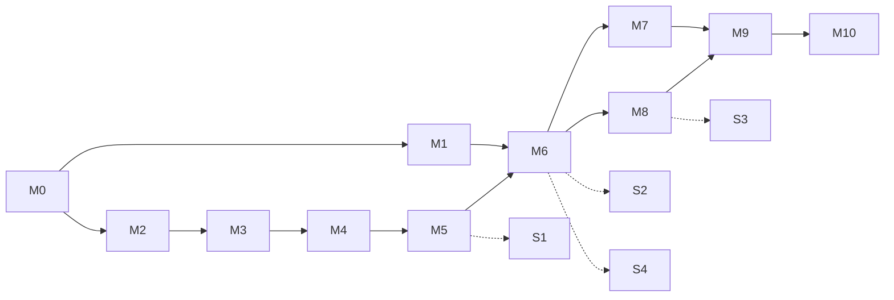

# RollCall Voice: build milestones

How we build the [PRD](docs/PRD.md): 11 milestones (M0 to M10) plus an optional stretch track. Each milestone depends only on earlier ones and ends in something you can run and check.

**Clock.** All times are Dallas (Central). Final submit: **Sun Nov 8, 12:00 pm**. This plan was written Sat Nov 7 at about 3:50 pm, so about 20 hours remain. This laptop's clock is on IST, where noon Central shows as 11:30 pm.

## How to use this file

- Work top to bottom. Start a milestone only when everything in its **Depends on** line is checked off.
- A milestone is done when every **Done when** box is ticked.
- Every milestone also ends with: tests for its code-only logic passing, the README's "How to run" updated, and the work committed and pushed.
- Write decisions (like the M1 gate result) in the [Decision log](#decision-log).

## Progress

- [ ] M0 Foundation and shared contracts
- [ ] M1 First real call (go/no-go gate)
- [ ] M2 Fake city and risk ranking
- [ ] M3 Response engine (code only)
- [ ] M4 Live map dashboard v1
- [ ] M5 Nemotron manager agent
- [ ] M6 Live voice in the loop
- [ ] M7 Simulated residents at scale
- [ ] M8 Follow-ups and approvals
- [ ] M9 Results: RollCall vs list order
- [ ] M10 Demo hardening and submission

## Overview

| # | Milestone | What you can show after it | Depends on | PRD items | Checkpoint |
|---|---|---|---|---|---|
| M0 | Foundation and shared contracts | Nemotron answers; events stream to a browser | none | Stack, data model | Sat 6 pm |
| M1 | First real call | A phone rings and Nemotron holds a check-in call | M0 | F6 (real), F7 | Sat 6 pm |
| M2 | Fake city and risk ranking | 2,000 homes with hidden truths and a ranked call list | M0 | F1, F3, F4, F5 | Sat 6 pm |
| M3 | Response engine (code only) | Alert to calls to help booked, on rules and scripted answers | M2 | F9 | Sat 11 pm |
| M4 | Live map dashboard v1 | Dots change color and counters climb live | M3 | F13 (map, counters, feed) | Sat 11 pm |
| M5 | Nemotron manager agent | Nemotron plans, triages and re-plans, and explains each step | M3, M4 | Goal 2 | Sat 11 pm |
| M6 | Live voice in the loop | The judge's phone rings, their home turns orange, help goes out, a text arrives | M1, M5 | F6, F7, F8, F10 | Sun 4 am |
| M7 | Simulated residents at scale | Nemotron plays residents; the full run is going in the background | M6 | F6 (sim), F14 | Sun 4 am |
| M8 | Follow-ups and approvals | "Not reached" falls to zero; costly actions wait for a click | M6 | F10, F11, F12, F13 | Sun 4 am |
| M9 | Results: RollCall vs list order | The results panel and the trap case side by side | M7, M8 | F14, Goal 5 | Sun 9 am (freeze) |
| M10 | Demo hardening and submission | Ten clean rehearsals; submitted | M9 | Demo, checklist | Sun 12 pm |
| S1–S4 | Stretch (optional) | Live NWS alerts, Spanish, photos, NVIDIA voice | See each | F2, F15–F17 | Before the freeze |



**Why this order**

- Voice is the PRD's biggest risk, so M1 tests it before anything relies on it.
- The loop is built in plain code (M3) before Nemotron drives it (M5). It can be tested in seconds, and it becomes the rule-based fallback the PRD asks for when a model call fails.
- The map (M4) comes before the agent, so you can watch the agent's decisions while building it.
- The live call (M6) plugs into a loop that already works end to end.
- The simulator (M7) starts once the agent's prompt and tools are final. The full run takes hours on free-tier rate limits, so it runs in the background while M8 is built. M7 and M8 don't depend on each other, so two people can build them at once.
- The milestones fall three, three, three, one and one into the PRD's five checkpoints.

## Design decisions this plan relies on

1. **The event log is the backbone.** Every change is written to the `events` table and pushed over a WebSocket. The dashboard draws only from events, so any run can be replayed.
2. **One call-channel interface.** The manager starts a call and later receives a result event, without knowing which channel ran it: scripted answers from the hidden truth (M3, no AI), Vapi (M6), simulated residents (M7), or a replay of cached results (M9, M10).
3. **One clock.** Real time with a speed-up for demos, or a simulated clock that jumps between events for tests. Every timer (call length, follow-ups, status updates) goes through it.
4. **Code does the math; Nemotron does the judgment.** Scoring, matching, costs and timers are code. Nemotron writes the plan, chooses the kind of help, re-plans and writes status updates. A re-plan returns one change from a fixed menu, and code applies it. Every model output is validated, retried once, then replaced by a rule.
5. **Triage depends only on the call.** Nemotron decides what a household needs from the call alone; which crew or shelter gets booked is decided later in code from live availability. Triage results can therefore be cached, so both test runs share the same conversations and decisions and differ only in call order. That keeps the list-order comparison fair and reruns free.
6. **One SQLite file per run** (live, test with RollCall, test with list order), each copied from the seeded base, so runs never collide.
7. **One shared voice-agent spec** (prompt plus tool schemas) used by both Vapi and the simulator, so "the test used the same agent" is true.
8. **Consent guard in code.** Only numbers on an allowlist (teammates, the handset given to the judge) can ever be called or texted. Every other household is simulated.
9. **The demo background is replayed.** During the demo the city runs from cached simulated results through the live manager; only the judge's home is a real call. It's quick, works within rate limits, and is honest ("simulated residents").

## Spec gaps, decided (change them if you disagree)

- **"Help on the way"**, for the time-to-help metric, is the moment a crew, bed or adjuster is assigned or a P1 is handed to a human, not when help arrives.
- **P2 help vs generator approval.** The PRD says both "P2 help goes out automatically" and "generator deliveries wait for approval." Here, the P2 crew goes out automatically (that counts as help on the way) and the generator request goes to the top of the approvals queue.
- **Approval threshold.** The PRD gives no amount; use $500 in config, with a cost table in code.
- **Waves vs the line limit.** Waves are risk tiers for the plan and the story. Calls start continuously in risk order, up to N lines.
- **Eight statuses, five colors.** "Calling" pulses; "no answer" and "escalated" stay gray, and escalated homes get a ring.
- **Follow-up fields.** Hidden truth gets `answers_on_attempt` (1, 2, 3 or never) and `replies_to_text`, so the follow-up ladder actually gets exercised.
- **The Spanish-only trap without the Spanish stretch.** Correct handling is to never mark the home safe and to route it to a Spanish-speaking human or a Spanish text.
- **Time.** Store UTC; show Central on the dashboard.

---

## M0: Foundation and shared contracts

**Goal:** a skeleton every later milestone plugs into, with the tables and event types settled once.
**Depends on:** nothing.

Build:

- Repo layout:
  ```
  backend/      FastAPI app (uv, Python 3.11)
    app/        config, db, models, events, llm, clock, geo, risk, resources,
                channels/, agent/ (voice spec, manager graphs, tools), routers/
    scripts/    smoke_llm, seed, vapi_setup, call_me, run_eval, preflight
    tests/
  dashboard/    React + Vite + TypeScript + Leaflet (created in M4)
  data/         warning_area.geojson, demo_households.example.yaml, runs/
  docs/         PRD.md
  ```
- `.env.example` with: NVIDIA keys (a comma-separated list, rotated, so every teammate's free key adds capacity), an OpenRouter key, one model ID per job (manager, voice, resident), Vapi and Twilio settings, the dispatcher's phone, and the public base URL. `.gitignore` covers `.env`, `data/runs/` and `data/demo_households.yaml`.
- SQLite schema for the PRD's seven tables, plus a `run_info` row (mode, policy, lines, seed). The eight statuses and their colors are defined once and shared.
- Event bus: `emit(type, payload)` writes to `events` and pushes to `/ws` subscribers; `GET /events?since=` serves catch-up and replay. Starter event types: `alert.received`, `plan.created`, `call.started`, `call.transcript`, `call.ended`, `need.recorded`, `household.status`, `action.created`, `approval.requested`, `approval.decided`, `sms.sent`, `sms.received`, `followup.scheduled`, `agent.note`, `status.update`.
- LLM client: one function for every job. Uses build.nvidia.com first and OpenRouter as fallback, turns thinking on or off per call, has a timeout with one retry, a concurrency cap, a disk cache keyed by request (for the simulator and tests), and records token usage.
- `scripts/smoke_llm.py`: asks each model a question with thinking on and off and prints time to first token. This confirms the real model IDs and the thinking flag.
- A new public GitHub repo, and a README stub that already has the "AI tools used" section the MLH rules require.

Done when:

- [x] `uv run uvicorn app.main:app` serves `/health`.
- [ ] The smoke test gets answers from the manager and voice models, prints time to first token, and falls back to OpenRouter when the NVIDIA key is unset. *(Script ready: needs keys in `.env`, then `smoke_llm` and `smoke_llm --no-nvidia`.)*
- [x] An event emitted from a script reaches a WebSocket client within a second and appears in `GET /events`. *(121–133 ms.)*
- [ ] The repo is public, with the README stub.

## M1: First real call (voice spike and go/no-go gate)

**Goal:** prove Vapi plus Nemotron can hold a natural phone call before anything else depends on it.
**Depends on:** M0.

Build:

- A public HTTPS tunnel to the backend. Install cloudflared or ngrok; neither is on this laptop yet.
- The custom-LLM endpoint Vapi calls for every reply: OpenAI-compatible and streaming, forwarding to the voice model with thinking off and short replies, and logging time to first token per turn.
- Shared voice-agent spec v1 (`agent/voice_spec.py`): the PRD's opening line, the five questions in order (skipping what's already answered), the urgency levels, the safety rules, and the under-two-minutes target. One tool, `record_need`, wired to the backend.
- `scripts/vapi_setup.py`, which creates or updates the Vapi assistant from code (prompt, voice, transcriber, LLM URL, server URL) so its config lives in git.
- `scripts/call_me.py <phone> <name>` to place an outbound call.
- Try the voice candidates from NVIDIA's catalog (`nemotron-3.5-lightning-30b-a3b`, `nemotron-nano-3-30b-a3b`, and the small `nemotron-3.5-bolt-e4b`) and keep the fastest one that still calls tools correctly.
- Check the trial account's limits: which numbers it can call and how many outbound calls it allows.

Done when:

- [ ] A teammate's phone rings, they finish a natural check-in with Nemotron as the brain, and the call ends with a clear next step.
- [ ] `record_need` round-trips to the backend during the call, so tool calling through Vapi and Nemotron is proven.
- [ ] Replies come within about 1.5 s, and time to first token is logged per turn.
- [ ] The gate decision is written in the Decision log.

**If the gate fails** (or, per the PRD, voice still isn't solid by about 10 pm), switch to text check-ins: build an SMS check-in channel that runs the same spec over Twilio SMS and use it in place of Vapi in M6. Everything else stays the same.

## M2: Fake city and risk ranking

**Goal:** the fake world every test and demo runs on, and the code that decides who gets called first.
**Depends on:** M0. It can be built at the same time as M1.

Build:

- `scripts/seed.py --seed 42`, where the same seed always gives the same data:
  - A warning-area GeoJSON polygon over a Richardson, Garland and Plano neighborhood (F1).
  - 2,000 households inside and near it, with fake names, fake numbers (+1 555 …), fake addresses, coordinates and the PRD's risk fields (F3).
  - Hidden truth: roughly 5% P1–P2, 20% P3 and the rest P4. Urgency is correlated with the risk factors but not decided by them (a young family with a tree through the roof is still P2), so the calls matter. Also true needs, persona style, `answers_on_attempt` and `replies_to_text`, with 30 trap personas across the PRD's six styles.
  - Resources: 6 crews, 3 shelters with bed limits, 4 adjusters and 2 generators, spread around the area.
  - Demo households from `data/demo_households.yaml` (gitignored; teammates' verified phones), placed inside the polygon with high risk and `live=true`.
- `find_affected(polygon)`, a point-in-polygon check (F4).
- A risk score in code from the PRD's factors (age 75+, lives alone, powered medical device, mobility limits, no car, kids under 5, language needs, distance to the warning center), stored with its breakdown so the dashboard can show why (F5).
- Two ordering policies, `risk_ranked` and `list_order` (the baseline), plus wave tiers.
- `scripts/inspect_city.py`: counts by urgency and persona, the affected count, and the share of true P1+P2 homes in the first wave under each policy.

Done when:

- [ ] Seeding twice with the same seed gives identical data.
- [ ] The inspect script shows the roughly 5/20/75 urgency mix, 30 traps and the affected count.
- [ ] Risk ranking puts far more true P1+P2 homes in the first wave than list order does. If it doesn't, tune the generator now.
- [ ] Tests for scoring and point-in-polygon pass.

## M3: Response engine (code only, no AI yet)

**Goal:** the whole response loop running on rules and scripted answers. It's fast to test, and it becomes the fallback whenever a model call fails.
**Depends on:** M2.

Build:

- The clock: real time with a speed-up factor, and a simulated clock that jumps between scheduled events.
- The call-channel interface and `ScriptedChannel`, which answers from the hidden truth with realistic call lengths and no-answers, without any AI.
- The scheduler: a queue in policy order, up to N lines at once, status changes (not called, calling, result) and an event for each step.
- The help tools, mocked (F9): `dispatch_crew`, `reserve_shelter_bed`, `schedule_adjuster` and `open_claim` (filled in from the call), plus `schedule_followup` and `request_approval`, which only record for now (M8 makes them real).
- Matching in code: the nearest available resource with capacity, with `free_at` updated and crews kept busy for the length of a job.
- Rule triage from urgency to actions: P1 handoff, P2 crew, P3 crew or adjuster plus a claim, P4 safe. This becomes the agent's fallback.
- API: `POST /alerts/demo`, `POST /reset`, and `GET /state` (the dashboard's snapshot).
- Two run modes: live (real clock, `live.db`) and sim (simulated clock, its own run file).

Done when:

- [ ] `POST /alerts/demo` at 60× runs the whole affected area, events stream, and every affected household ends in a final status.
- [ ] The same run in sim mode finishes in seconds and gives the same result for the same seed.
- [ ] Tests pass for: no double booking, capacity respected, nearest available resource chosen, and only valid status changes.

## M4: Live map dashboard v1

**Goal:** the screen that tells the story without anyone talking.
**Depends on:** M3. It can start earlier against a fake event stream that follows M0's event types.

Build:

- React, Vite, TypeScript and react-leaflet. Load `GET /state`, then stream `/ws`, and reconnect if the connection drops.
- The map: 2,000 dots on a canvas layer colored by status (gray, green, yellow, orange, red, with calling homes pulsing), the warning area shaded, and a legend.
- Counters: called, reached, urgent, help sent, not reached yet.
- The agent feed: events in plain words, newest first.
- Controls: "Tornado warning" (calls `POST /alerts/demo`), Reset and clock speed.

Done when:

- [ ] Clicking "Tornado warning" changes dot colors and raises the counters live, staying smooth with 2,000 dots.
- [ ] Reloading the page mid-run shows the same state.
- [ ] A teammate who hasn't seen the code can narrate the run from the screen alone.

## M5: Nemotron manager agent

**Goal:** Nemotron runs the response. It plans, decides what help each home needs, re-plans when things change, and explains each step.
**Depends on:** M3, M4.

Build:

- A LangGraph loop around the engine: alert in, find affected homes, score, plan waves, launch calls, then wait for events. A call result triggers triage, a change triggers a re-plan, a timer triggers a status update, and then more calls launch.
- Plan: Nemotron 3 Super, with thinking on, reviews the ranked list and states it in one line ("312 high-risk homes first, in 3 waves").
- Triage for each call result, by Super with thinking off: confirm the urgency, choose the kinds of help, and give a one-sentence reason. Code then matches and books. Calls the voice agent already judged safe, with no needs or flags, skip the model. Triage runs in parallel up to a cap.
- Re-plan, with thinking on, when a new P1 appears, all crews are busy, or a shelter is full. It returns one change from a fixed menu (raise priority near a location, switch the help type, change the wave size, or flag the coordinator), and code applies it.
- A short status update for the coordinator every 10 clock-minutes.
- Guardrails: validate every output, retry once, and otherwise use the M3 rule. The feed says when a fallback was used.
- Feed lines in the PRD's style: "Sent crew 3 to 1412 Oak St: oxygen machine without power."
- Token usage recorded per household.

Done when:

- [ ] A demo run shows the one-line plan, a reason for every help decision, status updates every 10 clock-minutes, and at least one re-plan (for example, when crews run out) that visibly changes what happens next.
- [ ] Removing the API key mid-run lets the run finish on rules, and the feed says so.
- [ ] A test that feeds in malformed model output gets a retry and then the fallback, with no crash.

## M6: Live voice in the loop (the demo moment)

**Goal:** the judge's phone rings, they talk to the agent, their home changes on the map, help goes out and a text arrives.
**Depends on:** M1, M5.

Build:

- `VapiChannel` behind the call-channel interface, which dials only allowlisted numbers. Live households go through Vapi; the rest keep using the scripted channel (replayed simulations later).
- Per-call context: the household's name and address in the opening line, and its id in the call metadata.
- Vapi's server messages (status, live transcript, end-of-call report) feed the `calls` table and the event stream.
- The in-call tools from the shared spec, as backend endpoints:
  - `record_need`.
  - `flag_urgent`: the status changes right away. For P2, the nearest crew is booked in code and the result goes back so the agent can tell the caller help is coming.
  - `transfer_to_human`: a Vapi transfer to the dispatcher's phone, plus a handoff card (who, where, what's wrong, what's already done).
  - `send_text`: a real text message.
  - `end_call(summary)`: hands the result to the manager to arrange the rest (claim, adjuster, shelter).
- Outbound texts (F10): next steps after every reached call, and a number to call back for P4 homes. The allowlist applies here too.
- The safety rules in the prompt: say it's automated up front; for any danger, say "please hang up and call 911" and transfer; give no medical advice; never accept "I'm fine" without asking about powered devices and who's home; transfer whenever asked.
- Dashboard: a live call panel with the streaming transcript, and the P1 handoff card.
- Demo households pinned into wave 1.

Done when:

- [ ] Three times in a row: alert, the phone rings, the caller says "my oxygen machine keeps beeping," the dot turns orange during the call, the feed shows a crew sent, the agent tells the caller, a text arrives, and the transcript is on screen.
- [ ] Saying "I smell gas" makes the agent say to hang up and call 911, transfer to the dispatcher's phone, turn the dot red and show the handoff card.
- [ ] Asking "Can I talk to a person?" gets a transfer.
- [ ] Reply delay on real calls is logged (median and 90th percentile).

Risk: texts from unregistered US numbers can be filtered or blocked, so test texting early. Fallbacks are the phone platform's own texting, or showing the text in the dashboard.

## M7: Simulated residents at scale

**Goal:** Nemotron plays the residents over text, so the agent can be tested against the hidden truth. The full run takes hours, so it starts here.
**Depends on:** M6 (the final voice spec and tools).

Build:

- `SimChannel`: the shared voice spec talks over text with a Nemotron 3 Nano resident that knows its hidden truth and acts out its persona (normal, downplays, hard of hearing, Spanish only, confused or angry, "call my daughter," hangs up, never answers). Tool calls are recorded into the result with stand-in confirmations; the manager acts on them later, at replay (M9). Turns are capped.
- Each result is stored (transcript, tool calls, summary, a simulated length of about 2 minutes, tokens) and cached by household and prompt version, so editing the prompt invalidates old results and reruns are instant.
- A batch runner with a concurrency cap, backoff, key and provider rotation, progress display, and the ability to resume after a crash.
- Run it in tiers: the 30 traps, then a 200-home pilot, then the whole affected city in the background.

Done when:

- [ ] The 30 trap conversations read like real calls (spot-read five).
- [ ] The pilot finishes, and rerunning it hits the cache in seconds.
- [ ] The full run is going in the background, shows progress and survives a restart.

Note: measure the real rate limit during the pilot. If the full city won't finish by about 7 am, run a stratified subset instead (all true P1–P2 homes, all traps and a sample of the rest) and state its size in the results.

## M8: No one overlooked: follow-ups and approvals

**Goal:** every household ends safe, helped, or with a human, and costly actions wait for the coordinator.
**Depends on:** M6. It doesn't depend on M7, so the two can be built at once.

Build:

- The follow-up ladder on the clock (F11): no answer, then a call again in 10 minutes, then the text "Reply 1 safe, 2 need help, 3 emergency," then a final call 20 minutes later, then a crew for an in-person check flagged for the coordinator. Each no-answer goes back into the queue, and "not reached" never goes up.
- Inbound texts: a Twilio webhook turns 1, 2 or 3 into a status and a manager event; free-text replies go through triage.
- The scripted channel honors `answers_on_attempt` and `replies_to_text` (M9's replay does too).
- Approvals (F12): a cost table and threshold. P1 handoffs and P2 help go out automatically. Hotel vouchers, generators and anything over the threshold wait. Approving runs the action; rejecting makes the manager re-plan an alternative.
- Dashboard: the approvals queue with one-click approve and reject; the household panel (risk breakdown, needs, call history and transcripts, actions, next follow-up); and a list of escalations.

Done when:

- [ ] Never-answer households go through all four ladder steps and end escalated. "Not reached" reaches zero, and a test asserts it never rises.
- [ ] Texting "2" from a teammate's phone turns that home to "needs help" and sends help.
- [ ] A generator or hotel voucher waits in the queue; approving runs it, rejecting leads to an alternative, and both are logged with reasons.

## M9: Results: RollCall vs list order

**Goal:** the numbers for the pitch, each one from our own runs.
**Depends on:** M7, M8.

Build:

- `ReplayChannel`: the cached simulated results (with the attempt rules) run through the same manager on the simulated clock.
- `scripts/run_eval.py --lines 100`: runs the city twice, risk-ranked and list order, each in its own run file. Both use the same conversations and cached triage, so only the order differs.
- The PRD's metrics, scored against the hidden truth: urgent found, time until every true P1+P2 home has help on the way (and the median), false alarms, coverage, average call length and tokens per household. Also a curve of urgent homes helped over time for both runs.
- Keyword-rule triage on the same transcripts, side by side with Nemotron's, for the demo beat at 1:20.
- A trap report for the 30 personas against a written rubric. The downplayer is P1 or P2. A hang-up gets a follow-up and isn't marked safe. "Call my daughter" saves a second contact and follows up. Spanish only isn't marked safe and goes to Spanish help. Hard of hearing and confused or angry callers are finished or escalated, never guessed safe.
- Live reply delay (median and 90th percentile) from the real calls logged since M1.
- Output: `results/*.json` and `RESULTS.md`, stating the number of lines and saying plainly that the test is simulated.
- Dashboard test mode: load or run results; show RollCall vs list order with the curve and headline numbers, and the trap case side by side.
- One tuning pass: fix the prompt or scoring for misses, re-run only those homes (the cache makes this quick), and re-score.

Done when:

- [ ] One command rebuilds the results, and each number traces to a run file.
- [ ] The dashboard shows the 1:20 trap beat and the 1:35 results beat.
- [ ] The PRD targets are met (95% or more urgent found, 10% or fewer false alarms, 100% coverage, ratio vs list order reported), or each miss is listed with what was tried.
- [ ] Feature freeze at Sun 9:00 am.

## M10: Demo hardening and submission

**Goal:** the live call works on the first try in front of judges, and nothing on the checklist is missed.
**Depends on:** M9.

Build:

- Demo mode: one click runs the city from cached results at a speed that finishes in about 90 seconds, while the judge's home gets a real call in wave 1. The demo caller's name and phone are editable, and reset is one click.
- Backups: a recording of a full good run's events that replays with Wi-Fi off, a video of a good live call, and a phone hotspot.
- `scripts/preflight.py`: keys valid, tunnel URL matching the Vapi assistant, Twilio working, database seeded, dashboard connected, and a test call to the dispatcher's phone.
- The final README: what we built, how to run it, an architecture diagram, what's real and what's simulated, and the AI coding tools used.
- Screenshots or a GIF, a 2-minute video at a public link, and the final Devpost entry (NVIDIA and State Farm tracks, every teammate invited).
- Rehearse the 2-minute script 10 times (one person drives, one talks), and prepare answers to the PRD's judge questions using your real numbers.

Done when:

- [ ] Preflight passes.
- [ ] Ten clean rehearsals.
- [ ] The replay backup works offline.
- [ ] Submitted before Sun 12:00 pm Central.

## Stretch track (optional)

Pick these up only when you're ahead of the current checkpoint. Each ships behind a flag that's off by default and lands before the 9 am freeze; nothing in M0 to M10 depends on them. The order is by value per hour.

| # | Item | Needs | Why this order |
|---|---|---|---|
| S1 | Live NWS alerts (F2) | M5 | Small job that makes the trigger real data. The saved polygon stays the demo default. |
| S2 | Spanish (F15) | M6 | Answers the PRD's problem statement (people who struggle with English) and turns the Spanish-only trap into a pass. |
| S3 | Damage photos (F16) | M8 | Picture texts go to Nemotron Nano Omni and become a damage need plus an adjuster: another NVIDIA model in the story. |
| S4 | NVIDIA voice stack (F17) | M6 | The most NVIDIA points but the highest risk. Vapi stays the demo default. |

## Timeline (Central)

| Checkpoint | Milestones | Also due (not code) |
|---|---|---|
| Sat 6:00 pm | M0, M1, M2 | Gate decision |
| Sat 11:00 pm | M3, M4, M5 | **Devpost draft submitted** |
| Sun 4:00 am | M6, M7 (full run started), M8 | |
| Sun 9:00 am | M9 | Feature freeze |
| Sun 12:00 pm | M10 | Final submit |

**Team lanes** (the PRD's four owners): Voice takes M1 then M6 (then S2 or S4). Manager and backend takes M0, M3, M5 and M8 (then S1). Testing takes M2, M7 and M9. Dashboard builds M4 against fake events, then the UI parts of M6, M8 and M9, then M10's video and screenshots. Working solo, follow the numbers.

## If you fall behind, cut in this order

1. Stretch items.
2. The re-plan menu, down to one change type (keep the triggers and the explanation).
3. Extras in the household panel.
4. The full-city simulation, replaced by a stratified subset with its size stated.
5. Free-text replies to texts (keep 1, 2, 3).

Never cut: the live call to map to help to text moment, the follow-up ladder, approvals, the results vs list order, or the safety rules.

## PRD coverage

| PRD item | Where |
|---|---|
| F1 Saved warning area | M2 |
| F2 Live NWS alerts | S1 |
| F3 2,000 households | M2 |
| F4 Who's affected | M2 |
| F5 Risk score and call order | M2 (waves in M3 and M5) |
| F6 Real and simulated calls | M1, M6 (real); M7 (simulated) |
| F7 Voice agent | M1, M6 |
| F8 P1: 911 and a human | M6 |
| F9 Send help | M3 (help choice in M5) |
| F10 Texts | M6, M8 |
| F11 Follow-up ladder | M8 |
| F12 Approvals | M8 |
| F13 Dashboard | M4, M6, M8, M9 |
| F14 Test runner and metrics | M7, M9 |
| F15 Spanish | S2 |
| F16 Photos | S3 |
| F17 NVIDIA voice | S4 |
| Reply delay under ~1.5 s | M1, M6, M9 |
| Safety and privacy rules | M2 (fake data), M6 (prompt, allowlist), M5 and M8 (reasons logged, approvals) |
| Submission checklist | M0 (public repo, README stub), M10 (the rest), Devpost draft by Sat 11 pm |

## Decision log

- **M1 gate:** GO (voice) or NO-GO (text check-ins), with the time and reason.
- **Phone platform with credits** (PRD open question): Vapi, Twilio or Photon.
- **Team roles** (PRD open question): who owns each lane.
- **Spanish and NVIDIA voice** (PRD open questions): this plan makes both stretch items (S2, S4).
