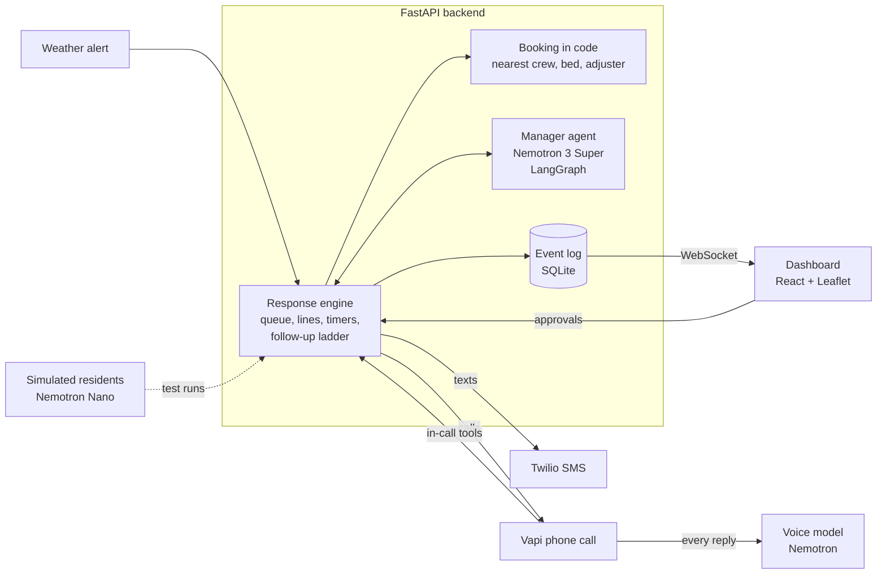

# RollCall Voice

RollCall Voice is an AI agent that phones every household in a disaster zone, works out who needs help most, and gets that help moving. It keeps calling back until every household is reached.

> "When a tornado hits Dallas, thousands of people are in its path. RollCall checks on every one of them in minutes and finds who needs help first."

Built at HackUTD 2026 for the NVIDIA "Use Nemotron Beyond a Chatbot" and State Farm "The Worst Day, at Scale" tracks. Product spec: [docs/PRD.md](docs/PRD.md). Build plan and status: [MILESTONES.md](MILESTONES.md). Latest results: [RESULTS.md](RESULTS.md). Demo runbook: [docs/DEMO.md](docs/DEMO.md).

## What it does

1. **A weather alert starts it.** No chat box. RollCall finds every home inside the warning area and ranks them by risk: age, living alone, medical devices that need power, mobility, no car, kids, language, distance to the center.
2. **It calls them in waves, highest risk first.** Nemotron talks to each person on the phone with a short, calm check-in. It says up front that it's automated, catches downplaying ("I'm fine, honey, my oxygen machine keeps beeping"), and records needs as it goes.
3. **It sends help.** Nemotron 3 Super decides what each household needs. Plain code books the nearest crew, shelter bed or adjuster that can get there soonest. Emergencies go to 911 and a human dispatcher right away. Costly items (generators, hotel vouchers) wait for the coordinator's one-click approval.
4. **It re-plans** when things change: a new emergency, every crew busy, shelters full.
5. **No one is overlooked.** If nobody answers, it calls again, then texts "Reply 1 safe, 2 need help, 3 emergency", then calls once more, then sends a crew to knock on the door. "Not reached" only ever goes down.
6. **One screen tells the story:** a live map of every home, counters, the agent's decisions in plain words, approvals, household details, and a results view comparing RollCall with calling down the list.

## How it fits together



- **Event log as the backbone.** Every change is an event in SQLite, pushed over a WebSocket. The dashboard draws only from events, so any run can be replayed.
- **One engine, many channels.** The engine starts a call and gets a result back, whether the call was a real phone call, scripted, simulated by Nemotron, or replayed. The same code runs a sped-up live demo or an instant simulated test.
- **Code does the math, Nemotron does the judgment.** Scoring, matching, costs and timers are code. Every model decision is validated, retried once, and replaced by a rule if needed, so the response never stalls.

| Job | Model | Thinking |
|---|---|---|
| Plan, triage, re-plan, status updates | Nemotron 3 Super (`nvidia/nemotron-3-super-120b-a12b`) | On for planning, off for quick decisions |
| Voice on the phone | Nemotron 3.5 Lightning (`nvidia/nemotron-3.5-lightning-30b-a3b`) | Off (speed first) |
| Simulated residents in the test | Nemotron 3 Nano (`nvidia/nemotron-nano-3-30b-a3b`) | Off |

All through build.nvidia.com, with OpenRouter as the fallback.

## What's real and what's simulated

- **Real:** the phone call, the agent, the tools, the decisions, the map, the texts to consenting phones.
- **Mocked:** households (2,000 fake homes around Richardson, Garland and Plano; phone numbers that can't be dialed), crews, shelters, adjusters and claims.
- **Simulated:** the 2,000-household test. Nemotron plays the residents, each with a hidden situation we score the agent against. [RESULTS.md](RESULTS.md) says which kind of calls each run used.
- **Safety:** the agent always says it's automated; any danger goes to 911 and a human; no medical advice; costly actions need approval; only allowlisted, consenting phones are ever called or texted.

## How to run

You need Python 3.11, [uv](https://docs.astral.sh/uv/) and Node 20+.

```bash
cp .env.example .env                    # add NVIDIA_API_KEYS (and OPENROUTER_API_KEY for fallback)
cd backend
uv sync
uv run python -m scripts.seed           # the fake city: 2,000 households
uv run uvicorn app.main:app --port 8100 --reload
```

The API runs on http://127.0.0.1:8100 (docs at `/docs`; contract in [docs/API.md](docs/API.md)). Then the dashboard, in a second terminal:

```bash
cd dashboard
npm install
npm run dev                             # http://127.0.0.1:5173
```

Click **Tornado warning**. Without model keys, decisions run on the backup rules and calls are scripted from the fake data, and the feed says so.

### A real phone call

You need a Vapi key and a phone number imported into Vapi from Twilio, Vonage or Telnyx (free Vapi numbers can't place outbound calls; a Twilio trial number can only call verified numbers). From `backend/`:

```bash
cloudflared tunnel --url http://localhost:8100     # put the https URL in PUBLIC_BASE_URL
uv run python -m scripts.vapi_setup                # put the printed VAPI_ASSISTANT_ID in .env
uv run python -m scripts.demo_caller --name "Maria" --phone +1XXXXXXXXXX   # the consenting demo phone
uv run python -m scripts.preflight                 # checks everything before a demo
```

Only call people who have agreed to it.

### The numbers

```bash
uv run python -m scripts.sim_calls --traps          # Nemotron plays the 30 trap residents
uv run python -m scripts.sim_calls --all            # the whole city (hours on free keys; resumable)
uv run python -m scripts.run_eval --nemotron        # RollCall vs list order -> RESULTS.md, results/latest.json
```

### Other tools

```bash
uv run pytest                                  # tests; no network or keys needed
uv run python -m scripts.inspect_city          # urgency mix, traps, risk ranking vs list order
uv run python -m scripts.run_sim --compare     # the whole city on a simulated clock, both call orders
uv run python -m scripts.smoke_llm             # Nemotron answers, with time to first token
uv run python -m scripts.events_cli watch      # print live events
```

## AI tools used

Per the MLH rules: this project was written with help from Claude Code (Anthropic) as an AI coding assistant. At runtime the agent uses NVIDIA Nemotron models.
